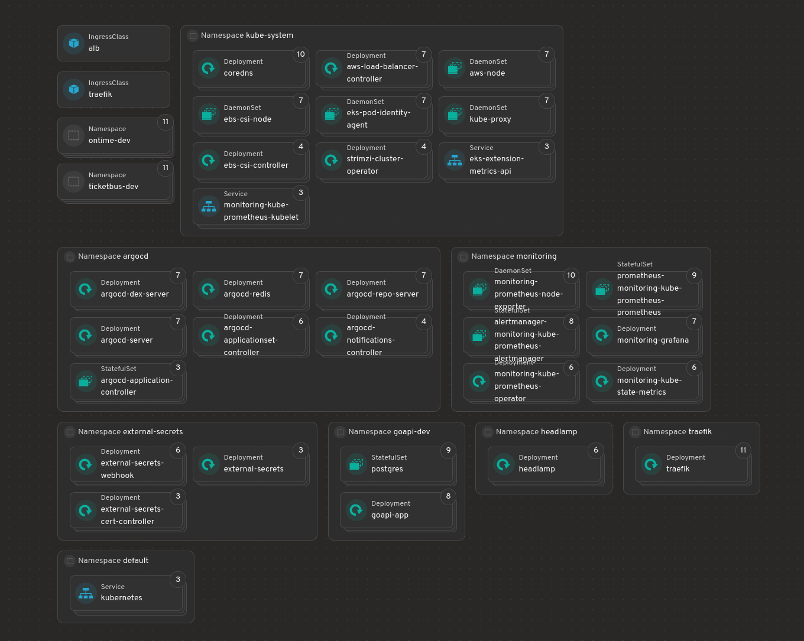
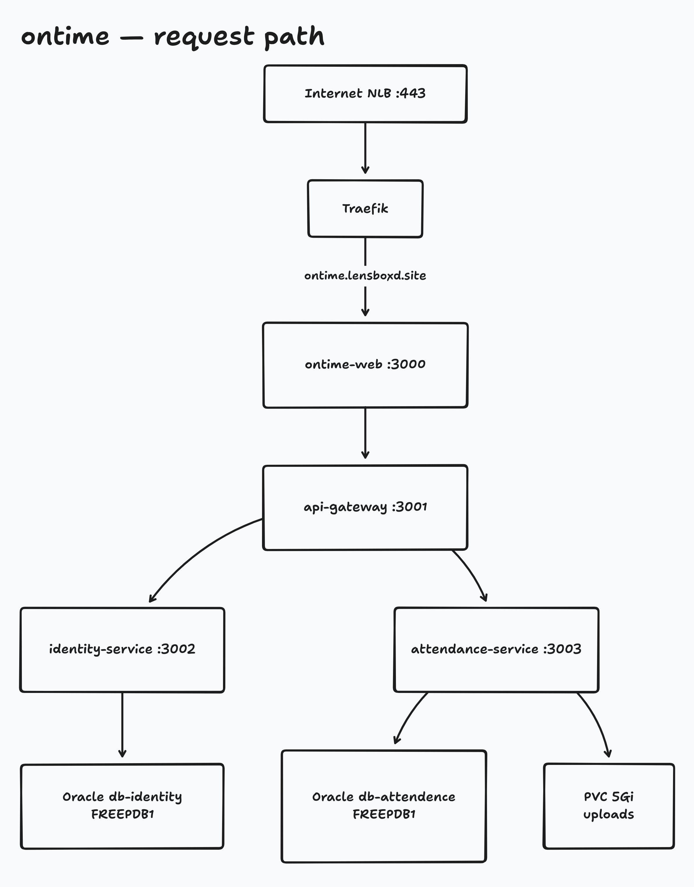
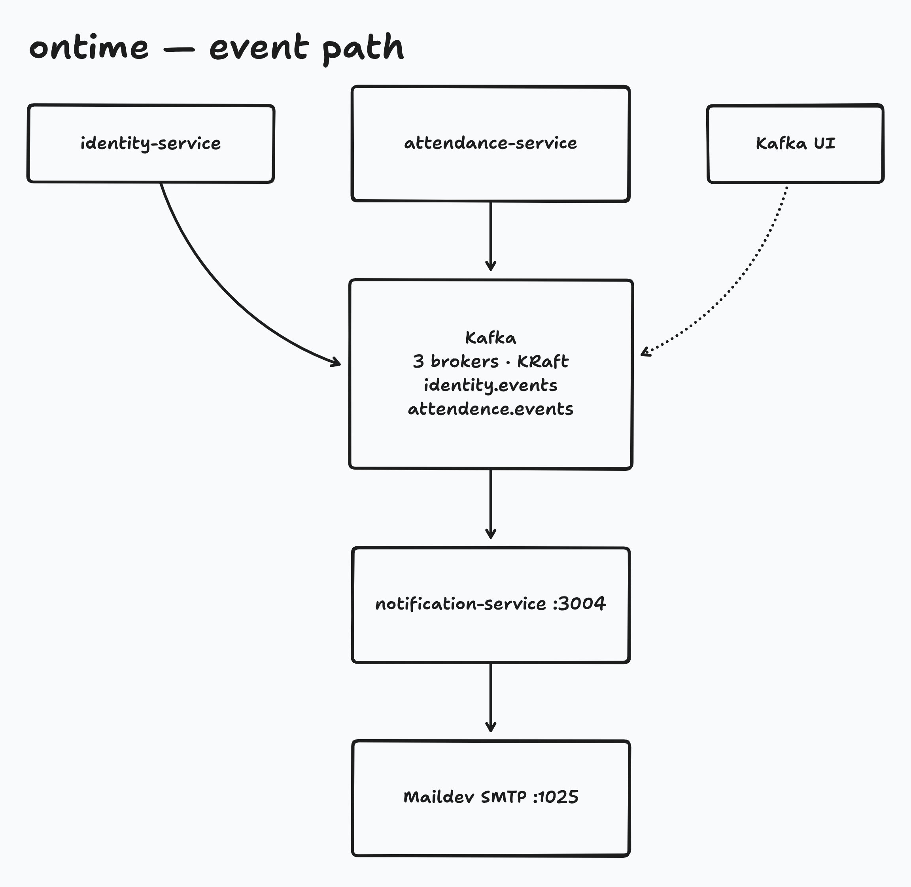
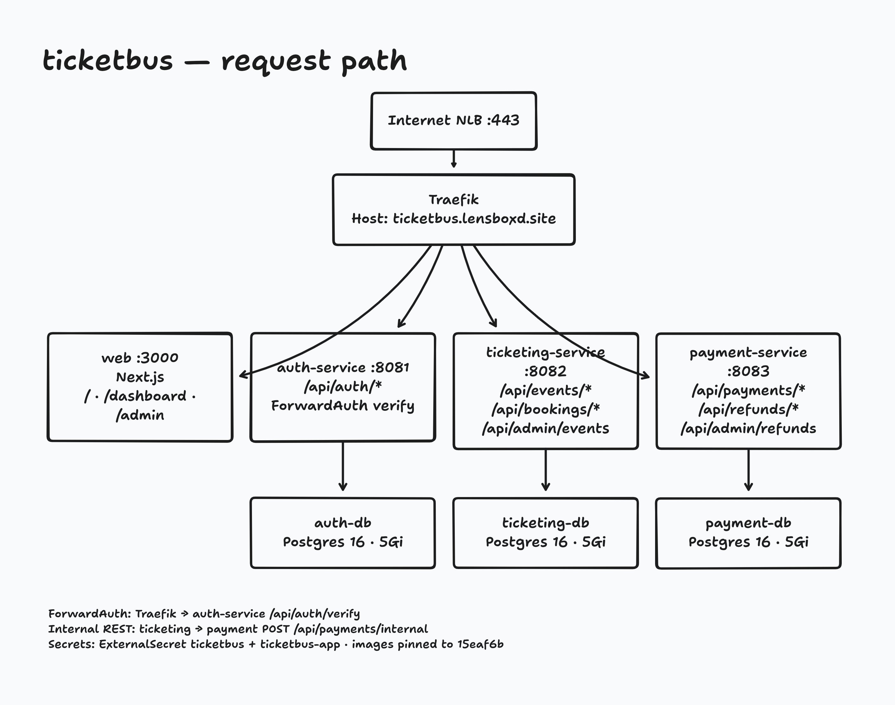
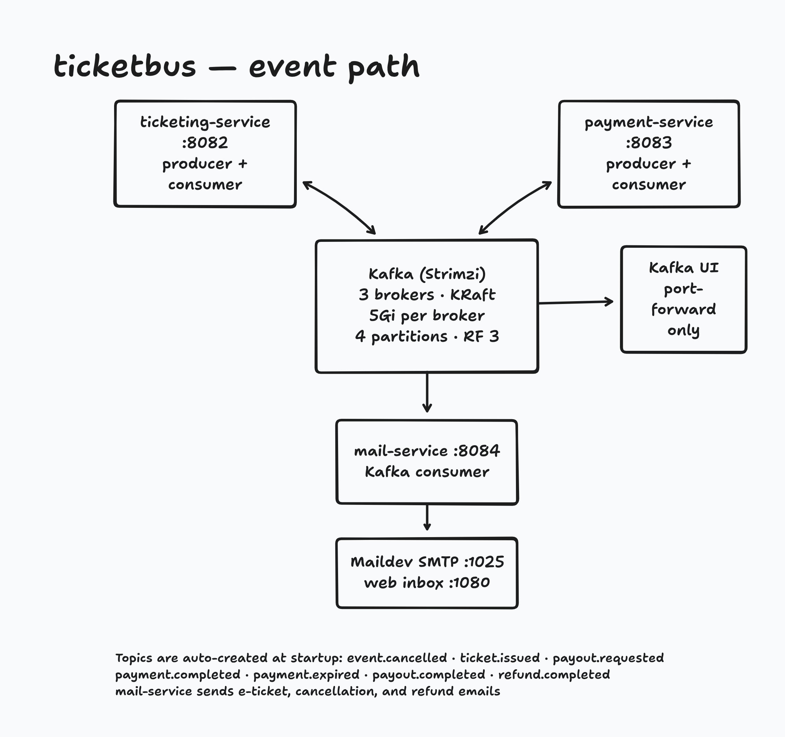

# Kubernetes Platform and Applications

This folder contains the Kubernetes layer for the AWS EKS lab. `goapi-dev` and
`ontime-dev` are managed by Argo CD; the shared platform is installed with Helm;
and every application workload is delivered from Kustomize overlays in this
repository. `ticketbus-dev` is currently applied manually with `kubectl`.

The documentation is split into four areas:

1. **Platform** — Argo CD, Traefik, AWS Load Balancer Controller, External
   Secrets, EBS CSI, Strimzi, monitoring, and Headlamp.
2. **goapi apps** — the `goapi-dev` application and its PostgreSQL database.
3. **ontime apps** — the `ontime-dev` services, Kafka, Oracle, and test tools.
4. **ticketbus apps** — the `ticketbus-dev` API, web, Kafka, PostgreSQL, and
   Traefik routing.

The editable tldraw canvas with all four architecture areas is here:

[Open the editable tldraw canvas](docs/k8s-architecture.tldraw)

> `kubectl` requires the OpenVPN connection because the EKS public API endpoint
> is disabled. The application hosts are still reachable through the
> internet-facing NLB.

---

## Cluster workload overview

Headlamp map view of the namespaces and their workloads:

[](docs/cluster-workloads.png)

Snapshot from the running cluster. Counts change as pods restart or workloads
scale.

| Namespace | Pods | Deployments | StatefulSets | DaemonSets | Services | Main workloads |
|---|---:|---:|---:|---:|---:|---|
| `kube-system` | 31 | 4 | — | 4 | 5 | coreDNS, AWS Load Balancer Controller, EBS CSI controller and node, VPC CNI, kube-proxy, EKS Pod Identity agent, Strimzi operator |
| `argocd` | 7 | 6 | 1 | — | 5 | Argo CD server, repo-server, redis, dex, applicationset, notifications, application-controller |
| `monitoring` | 11 | 3 | 2 | 1 | 8 | Prometheus, Grafana, Alertmanager, kube-state-metrics, node-exporter, operator |
| `external-secrets` | 3 | 3 | — | — | 1 | External Secrets controller, webhook, cert-controller |
| `traefik` | 5 | 1 | — | — | 1 | Traefik ingress controller |
| `goapi-dev` | 4 | 1 | 1 | — | 3 | goapi-app, PostgreSQL |
| `ontime-dev` | 13 | 8 | 2 | — | 11 | ontime-web, api-gateway, identity, attendance, notification, Kafka, Oracle, Kafka UI, Maildev |
| `ticketbus-dev` | 13 | 7 | 3 | — | 15 | web, auth, ticketing, payment, mail, Kafka, three PostgreSQL databases, Kafka UI, Maildev |
| `headlamp` | 1 | 1 | — | — | 1 | Headlamp |
| `default` | — | — | — | — | 1 | `kubernetes` Service |

`goapi-prod`, `ontime-prod`, and `ticketbus-prod` exist but currently have no
workloads.

Kafka broker pods are managed by StrimziPodSets, not StatefulSets, so they
appear in the Pods column but not the StatefulSets column.

IngressClass: `alb` and `traefik`. All application Services are `ClusterIP` or
headless; the only public entry point is the NLB → Traefik.

---

## Platform

[](docs/platform.jpg)

The platform is split across four Helm releases:

| Release | Namespace | Chart | Purpose |
|---|---|---|---|
| `platform` | `kube-system` | `platform/core` | Shared cluster services: Argo CD, Traefik, AWS Load Balancer Controller, External Secrets, EBS CSI, and Strimzi. |
| `platform-apps` | `argocd` | `platform/apps` | Argo CD `Application` objects for `goapi-dev` and `ontime-dev`, plus the Traefik `TargetGroupBinding`. `ticketbus-dev` is applied manually for now. |
| `monitoring` | `monitoring` | `platform/monitoring` | `kube-prometheus-stack`: Prometheus, Grafana, Alertmanager, node-exporter, and kube-state-metrics. |
| `headlamp` | `headlamp` | `platform/headlamp` | Cluster UI for browsing workloads and resources. |

### Platform components

| Component | Namespace | Simple explanation |
|---|---|---|
| **Argo CD** | `argocd` | GitOps controller. It watches the GitHub `HEAD` revision and keeps `goapi-dev` and `ontime-dev` in sync with the overlays in this repository. Auto-sync, self-heal, and prune are enabled. `ticketbus-dev` is applied manually for now. |
| **Traefik** | `traefik` | Ingress controller with 5 replicas. The Service is `ClusterIP:80`; the NLB forwards TLS :443 to it. It routes by `Host` using `IngressRoute` resources. |
| **AWS Load Balancer Controller** | `kube-system` | Registers Traefik Pod IPs into the NLB target group through the `TargetGroupBinding` in `platform-apps`. It does not create a second load balancer. |
| **External Secrets** | `external-secrets` | Reads `lab-eks/external-secrets/app-2` from AWS Secrets Manager and creates Kubernetes Secrets for the applications, including ticketbus `ticketbus` (DB credentials) and `ticketbus-app` (JWT, internal keys, payment tokens, S3 keys). Uses a `SecretStore` backed by EKS Pod Identity. |
| **EBS CSI driver** | `kube-system` | Provides the `gp3` StorageClass used by Kafka, Oracle, PostgreSQL, Prometheus, attendance uploads, and the ticketbus databases and Kafka brokers. The class uses `WaitForFirstConsumer` and allows volume expansion. |
| **Strimzi** | `kube-system` (operator) | Kafka operator. It watches `ontime-dev`, `ontime-prod`, `ticketbus-dev`, and `ticketbus-prod` and reconciles the `Kafka`/`KafkaNodePool` resources in both stacks. |
| **kube-prometheus-stack** | `monitoring` | Prometheus (24h retention, 20Gi PVC), Grafana, Alertmanager, node-exporter, and kube-state-metrics. Alertmanager sends mail to Maildev SMTP in `ontime-dev`. |
| **Headlamp** | `headlamp` | Web UI for the cluster. It runs with a `cluster-admin` service account and is accessed by `kubectl port-forward`, not exposed by the NLB. |
| **TargetGroupBinding** | `traefik` | Maps the `traefik` Service to the Terraform-managed NLB target group. This is the bridge between the AWS NLB and the in-cluster Traefik pods. |

The platform chart creates the base namespaces (`traefik`, `argocd`,
`external-secrets`, `ontime-dev`, `ticketbus-dev`, and `ticketbus-prod`). Argo CD
creates `goapi-dev` through `CreateNamespace=true`.

### Platform access

```bash
# Argo CD UI
kubectl -n argocd port-forward svc/argocd-server 8080:443

# Grafana
kubectl -n monitoring port-forward svc/monitoring-grafana 3000:80

# Headlamp
kubectl -n headlamp port-forward svc/headlamp 4466:80
```

Grafana uses the `grafana-admin` Secret. Argo CD uses its standard
`argocd-initial-admin-secret` on a fresh install.

---

## goapi Apps

[](docs/goapi.jpg)

Argo CD Application: `goapi-dev`

| Item | Value |
|---|---|
| Source path | `aws_kube/k8s/apps/goapi/overlays/dev` |
| Namespace | `goapi-dev` |
| Sync policy | Automated, self-heal, prune |
| Image | `unedotamps/goapi-app`, pinned in the overlay |

### Components

| Component | Kind | Simple explanation |
|---|---|---|
| `goapi-app` | Deployment | The Go API. It runs 3 replicas in `goapi-dev`, listens on `:8080`, and exposes `/healthz` and `/readyz` probes. |
| `goapi-service` | Service | Stable ClusterIP on port `80`, forwarding to the `goapi-app` pods on `:8080`. |
| `postgres` | StatefulSet | PostgreSQL 16 (`postgres:16-alpine`) with one replica and a 10Gi `gp3` PVC. It is the `goapi` database. |
| `postgres` / `postgres-headless` | Services | ClusterIP and headless Services on port `5432` for the database. |
| `goapi-app-credentials` | ExternalSecret | Reads the application username from AWS Secrets Manager. |
| `postgres-credentials` | ExternalSecret | Reads database username, password, and database name from AWS Secrets Manager. |
| `route-ingress` | IngressRoute | Routes `traefik.lensboxd.site` to `goapi-service:80`. |

### Request flow

```text
Internet
  -> NLB :443
  -> Traefik (Host: traefik.lensboxd.site)
  -> goapi-service :80
  -> goapi-app :8080 (3 replicas)
  -> postgres :5432
      -> PVC 10Gi gp3
```

External Secrets supplies both the application credential and the PostgreSQL
credential from `lab-eks/external-secrets/app-2`.

To change the deployed image, update `images.newTag` in
`aws_kube/k8s/apps/goapi/overlays/dev/kustomization.yaml`, commit, and let Argo
CD sync.

### goapi access

```bash
kubectl -n goapi-dev port-forward svc/goapi-service 8080:80
```

The public host is `https://traefik.lensboxd.site` through the NLB and Traefik.

---

## ontime Apps

**Request path**

[](docs/ontime-request.jpg)

**Event path**

[](docs/ontime-events.jpg)

Argo CD Application: `ontime-dev`

| Item | Value |
|---|---|
| Source path | `aws_kube/k8s/apps/ontime/overlays/dev` |
| Namespace | `ontime-dev` |
| Sync policy | Automated, self-heal, prune |
| Images | `ontime-web`, `ontime-api-gateway`, `ontime-identity`, `ontime-attendence`, `ontime-notification`, pinned in the overlay |

### Components

| Component | Kind | Simple explanation |
|---|---|---|
| `ontime-web` | Deployment | Frontend on `:3000`. `IngressRoute/ontime-web-ingress` publishes it at `ontime.lensboxd.site`. |
| `api-gateway` | Deployment | Internal API gateway on `:3001`. Calls `identity-service` and `attendence-service`. |
| `identity-service` | Deployment | Identity and user service on `:3002`. Uses Oracle `db-identity` and publishes identity events to Kafka. |
| `attendence-service` | Deployment | Attendance service on `:3003`. Uses Oracle `db-attendence`, publishes attendance events, and stores uploaded files in a 5Gi PVC. It stays at one replica because the volume is `ReadWriteOnce`. |
| `notification-service` | Deployment | Kafka consumer on `:3004`. Sends email through Maildev SMTP on `:1025` and calls `identity-service` when needed. |
| `ontime` | Kafka (Strimzi) | Three KRaft brokers with 10Gi `gp3` volumes each. Topics `identity.events` and `attendence.events` use 4 partitions, replication factor 3, and `min.insync.replicas=2`. |
| `broker` | KafkaNodePool | The Strimzi node pool managed by the `ontime` Kafka resource: controller and broker roles, 3 replicas. The pods are named `ontime-broker-*`. |
| `db-identity` | StatefulSet | Oracle Free (`gvenzl/oracle-free:23-slim`) with a 20Gi `gp3` PVC. PDB `FREEPDB1` stores identity data. |
| `db-attendence` | StatefulSet | Oracle Free with a 20Gi `gp3` PVC. PDB `FREEPDB1` stores attendance data. The dev overlay adds restart hardening (`/dev/shm` cleanup, diagnostic log volume, and a longer liveness window). |
| `attendence-uploads` | PVC | 5Gi `gp3` shared by `attendence-service` for local upload files. Replace this with object storage before scaling attendance horizontally. |
| `kafka-ui` | Deployment | Kafka UI on `:8080`, exposed only through `kubectl port-forward`. Useful for topics, consumer groups, and messages. |
| `maildev` | Deployment | Development SMTP (`:1025`) and web inbox (`:1080`). Used by `notification-service` and Alertmanager. |
| Oracle credential secrets | ExternalSecret | Supplies the Oracle application and admin credentials from AWS Secrets Manager. |
| `ontime-web-ingress` | IngressRoute | Routes `ontime.lensboxd.site` to `ontime-web:80`. |

### Request and event flow

```text
Internet
  -> NLB :443
  -> Traefik (Host: ontime.lensboxd.site)
  -> ontime-web :3000
  -> api-gateway :3001
  -> identity-service :3002  -> Oracle db-identity / FREEPDB1
  -> attendence-service :3003 -> Oracle db-attendence / FREEPDB1
                              -> PVC 5Gi (uploads)
                              -> Kafka (attendance events)

Kafka
  -> notification-service :3004 -> Maildev SMTP :1025

Kafka UI -> Kafka (port-forward only)
```

Storage summary:

| Workload | PVC |
|---|---|
| Kafka brokers | 3 × 10Gi `gp3` |
| Oracle identity | 20Gi `gp3` |
| Oracle attendance | 20Gi `gp3` |
| Attendance uploads | 5Gi `gp3` |

### ontime access

```bash
# Kafka UI
kubectl -n ontime-dev port-forward svc/kafka-ui 8080:80

# Maildev web inbox
kubectl -n ontime-dev port-forward svc/maildev 1080:1080

# Oracle databases
kubectl -n ontime-dev port-forward svc/db-identity 1521:1521
kubectl -n ontime-dev port-forward svc/db-attendence 1521:1521
```

The Oracle services use `FREEPDB1` as the service name. The application
credentials are created by External Secrets.

---

## ticketbus Apps

**Request path**

[](docs/ticketbus-request.jpg)

**Event path**

[](docs/ticketbus-events.jpg)

Delivery: **manual** for now. There is no Argo CD Application for
`ticketbus-dev`; deploy it with the Kustomize overlay.

| Item | Value |
|---|---|
| Source path | `aws_kube/k8s/apps/ticketbus/overlays/dev` |
| Namespace | `ticketbus-dev` |
| Delivery | Manual `kubectl apply -k` (Argo CD Application not added yet) |
| Images | Pinned to `15eaf6b` in the overlay |
| Public host | `ticketbus.lensboxd.site` |
| Entry point | One `IngressRoute` with CORS, rate limit, and ForwardAuth |

### Components

| Component | Kind | Simple explanation |
|---|---|---|
| `web` | Deployment | Next.js 16 on `:3000`. The Service `web` exposes port `80`. Traefik routes `/`, `/dashboard`, `/admin`, `/checkout`, and other non-API paths here. |
| `auth-service` | Deployment | Authentication and RBAC on `:8081`. Owns `/api/auth/*` and the Traefik ForwardAuth endpoint `/api/auth/verify`. Uses `auth-db`. |
| `ticketing-service` | Deployment | Events, bookings, and organizer payouts on `:8082`. Owns `/api/events/*`, `/api/bookings/*`, `/api/payout-account`, `/api/admin/events`, and `/api/admin/payouts`. Uses `ticketing-db`, Kafka, and S3-compatible storage for event photos. |
| `payment-service` | Deployment | Transactions, webhooks, refunds, and payouts on `:8083`. Owns `/api/payments/*`, `/api/refunds/*`, `/api/refund-account`, and `/api/admin/refunds`. Uses `payment-db` and Kafka. `PROVIDER=mock` in this environment. |
| `mail-service` | Deployment | Kafka consumer on `:8084`. Sends e-ticket, cancellation, and refund emails through Maildev SMTP. |
| `ticketbus` | Kafka (Strimzi) | Three KRaft brokers with 5Gi `gp3` volumes each. New topics use 4 partitions, replication factor 3, and `min.insync.replicas=2`. |
| `broker` | KafkaNodePool | The Strimzi node pool managed by the `ticketbus` Kafka resource: controller and broker roles, 3 replicas. |
| `auth-db` | StatefulSet | PostgreSQL 16 with one replica and a 5Gi `gp3` PVC. |
| `ticketing-db` | StatefulSet | PostgreSQL 16 with one replica and a 5Gi `gp3` PVC. |
| `payment-db` | StatefulSet | PostgreSQL 16 with one replica and a 5Gi `gp3` PVC. |
| `ticketbus` | ExternalSecret | DB credentials from `lab-eks/external-secrets/app-2`: `auth_db_*`, `ticketing_db_*`, and `payment_db_*`. |
| `ticketbus-app` | ExternalSecret | JWT keys, admin seeds, internal API keys, webhook token, Xendit key, and S3 access keys from the same AWS secret. |
| `ticketbus-api` | IngressRoute | Single router table for the web, auth, ticketing, and payment services. Protected routes use ForwardAuth; webhooks and public event reads do not. |
| `kafka-ui` | Deployment | Kafka UI on `:8080`. ClusterIP only; access with `kubectl port-forward`. |
| `maildev` | Deployment | Development SMTP on `:1025` and web inbox on `:1080`. |

### Request flow

```text
Internet
  -> NLB :443
  -> Traefik (Host: ticketbus.lensboxd.site)
  -> web :3000                    /, /dashboard, /admin, /checkout
  -> /api/auth/*       -> auth-service :8081      -> auth-db :5432
  -> /api/events/*     -> ticketing-service :8082 -> ticketing-db :5432
  -> /api/bookings/*   -> ticketing-service :8082
  -> /api/payments/*   -> payment-service :8083   -> payment-db :5432
  -> /api/refunds/*    -> payment-service :8083
```

Traefik calls the auth service for ForwardAuth on protected routes:

```text
Traefik -> auth-service :8081 /api/auth/verify
```

The ticketing service calls the payment service internally over REST:

```text
ticketing-service -> payment-service :8083 POST /api/payments/internal
```

### Event flow

```text
ticketing-service -> Kafka: event.cancelled, ticket.issued, payout.requested
payment-service   -> Kafka: payment.completed, payment.expired,
                            payout.completed, refund.completed

Kafka -> ticketing-service: payment.completed, payment.expired, payout.completed
Kafka -> payment-service: event.cancelled, payout.requested
Kafka -> mail-service: ticket.issued, event.cancelled, refund.completed

mail-service -> Maildev SMTP :1025
```

The applications create their topics at startup. The Kafka cluster defaults
new topics to 4 partitions with replication factor 3.

### Routes that are not public

These paths have no `IngressRoute`. They are reachable only inside the cluster:

- `/api/payments/internal` — ticketing to payment service-to-service call.
- `/api/payments/booking/mock` — dev-only payment webhook simulator.
- `/api/payments/payout/mock` — dev-only payout webhook simulator.

### Storage summary

| Workload | PVC |
|---|---|
| Kafka brokers | 3 × 5Gi `gp3` |
| `auth-db` | 5Gi `gp3` |
| `ticketing-db` | 5Gi `gp3` |
| `payment-db` | 5Gi `gp3` |

### ticketbus access

```bash
# Web
kubectl -n ticketbus-dev port-forward svc/web 3000:80

# API health
kubectl -n ticketbus-dev port-forward svc/auth-service 8081:8081
kubectl -n ticketbus-dev port-forward svc/ticketing-service 8082:8082
kubectl -n ticketbus-dev port-forward svc/payment-service 8083:8083

# Kafka UI
kubectl -n ticketbus-dev port-forward svc/kafka-ui 8080:80

# Maildev web inbox
kubectl -n ticketbus-dev port-forward svc/maildev 1080:1080
```

The public host is `https://ticketbus.lensboxd.site`. The web image is built
with `NEXT_PUBLIC_API_URL=https://ticketbus.lensboxd.site`; rebuild it if the
public host changes. Event photos use S3-compatible storage; replace the
`S3_ENDPOINT`, `S3_BUCKET_NAME`, and `S3_PUBLIC_URL` placeholders in
`base/apps/configmap.yaml` with the real bucket details.

---

## GitOps Workflow

`platform/apps` creates the Argo CD Applications for `goapi-dev` and
`ontime-dev`. Both applications use:

- `repoURL: https://github.com/unedtamps/aws.git`
- `targetRevision: HEAD`
- `path: aws_kube/k8s/apps/<app>/overlays/dev`
- automated sync with self-heal and prune
- retry with exponential backoff

Typical workflow:

```bash
# Check application health
kubectl -n argocd get applications

# Change an image tag in the overlay
# aws_kube/k8s/apps/<app>/overlays/dev/kustomization.yaml

git add aws_kube/k8s/apps/<app>/overlays/dev/kustomization.yaml
git commit -m "deploy: update <app> image"
git push

# Argo CD reconciles the new revision
```

`ticketbus-dev` is outside Argo CD for now. Apply it manually:

```bash
kubectl apply -k aws_kube/k8s/apps/ticketbus/overlays/dev
```

Database and Kafka volumes are retained with `gp3` PVCs. Deleting a pod does
not delete its PVC or data.
