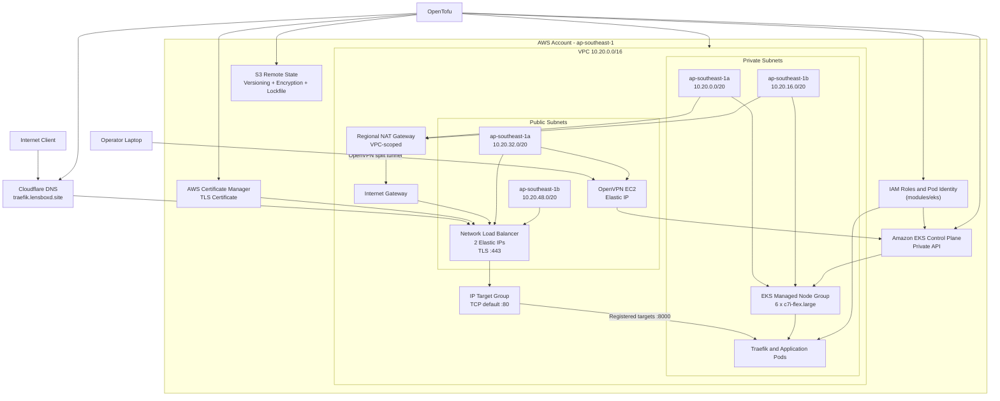
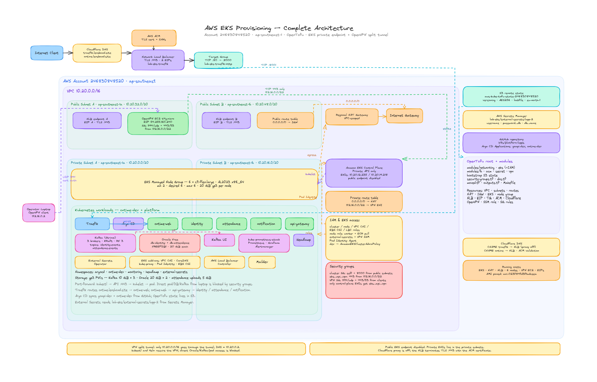
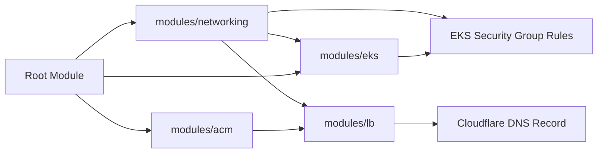

# AWS EKS Provisioning

This folder contains the OpenTofu configuration for the main Cloud Engineering
Lab infrastructure on AWS. The stack covers remote state, a multi-AZ network,
IAM, Amazon EKS, TLS certificates, an internet-facing NLB, security group
rules, Cloudflare DNS, and an OpenVPN server for private EKS API access.

Kubernetes workloads are not managed from this folder. After provisioning,
continue with the [Kubernetes documentation](../k8s/README.md).

## AWS Architecture



The Mermaid diagram above is a lightweight, source-controlled overview. The
complete provisioning diagram is below.

### Complete Provisioning Diagram



[Open the editable diagram in Excalidraw](https://excalidraw.com/#json=m3v3sGFV0BBKWbb3UjrEb,zGMfu7TCeTV7TIB2ZQLkfA)

The complete diagram shows three paths:

- Control path: OpenTofu creates AWS resources and stores state in S3.
- Application data path: clients enter through Cloudflare, the NLB, the target
  group, Traefik, and then the application pods.
- Administrative path: operators connect through OpenVPN and reach the EKS
  private API. The public EKS endpoint is disabled.

## Module Dependencies



## Folder Structure

```text
provision/
|-- bootstrap/
|   `-- main.tf                 # Creates the S3 remote-state bucket
|-- docs/
|   `-- provision-architecture.png
|-- modules/
|   |-- acm/                    # Certificate and DNS validation
|   |-- eks/                    # Cluster, node group, access, Pod Identity, IAM
|   |-- lb/                     # NLB, EIP, listener, and target group
|   |-- networking/             # VPC, subnets, routes, IGW, and NAT
|   `-- vpn/                    # OpenVPN server for private EKS access
|-- backend.tf                  # S3 backend configuration
|-- dns.tf                      # Public CNAME pointing to the NLB
|-- main.tf                     # Root module composition
|-- outputs.tf                  # Cross-stage deployment outputs
|-- provider.tf                 # AWS and Cloudflare providers
|-- security-groups.tf          # NLB-to-Traefik and VPN-to-EKS API rules
|-- variables.tf                # Root module inputs
|-- versions.tf                 # OpenTofu and provider versions
|-- vpn.tf                      # OpenVPN server and VPN client return route
`-- Makefile                    # plan, apply, and destroy workflow
```

## Component Details

### Remote State

The `bootstrap` stack uses local state to create the
`aws-kube-tofu-state-246830848520` bucket. The bucket is configured with:

- S3 versioning.
- Server-side encryption using `AES256`.
- Public access block.
- Bucket owner enforced.
- A policy that rejects connections without HTTPS.
- `force_destroy = false` to prevent accidental deletion of bucket contents.

The main stack uses the key `aws-kube/dev/eks/terraform.tfstate` and native S3
lockfile. If the bucket name or bootstrap state key changes, update
`backend.tf` as well; the bootstrap outputs do not change the backend
automatically.

### Networking

| Network | Availability Zone | CIDR | Purpose |
|---|---|---|---|
| Private subnet A | `ap-southeast-1a` | `10.20.0.0/20` | EKS nodes and pods |
| Private subnet B | `ap-southeast-1b` | `10.20.16.0/20` | EKS nodes and pods |
| Public subnet A | `ap-southeast-1a` | `10.20.32.0/20` | NLB, EIPs, internet egress, VPN |
| Public subnet B | `ap-southeast-1b` | `10.20.48.0/20` | NLB, EIPs, and internet egress |

The VPC uses `10.20.0.0/16`. Both private subnets use a single regional NAT
Gateway for outbound access. Subnets also carry the Kubernetes discovery tags
for internal and internet-facing load balancers.

### IAM and EKS

IAM roles for EKS and its add-ons live in `modules/eks`. `modules/secret` owns
the External Secrets role, and `modules/vpn` owns the SSM role for the VPN EC2
instance. `modules/lb` intentionally has no IAM because the NLB does not assume
a role; the Load Balancer Controller role is a pod identity, not an NLB
resource.

The IAM roles previously lived in `modules/iam`. They were merged into
`modules/eks`; `moved.tf` preserves the state addresses without replacing any
role.

| Identity | Used by | Main permissions |
|---|---|---|
| EKS cluster role | EKS control plane | `AmazonEKSClusterPolicy` |
| EKS node role | Managed node group | Worker, VPC CNI, and ECR pull policies |
| VPC CNI role | `kube-system/aws-node` | EKS Pod Identity for pod networking |
| Load Balancer Controller role | `kube-system/aws-load-balancer-controller` | EKS Pod Identity for target group registration |
| EBS CSI role | `kube-system/ebs-csi-controller-sa` | EKS Pod Identity for EBS volumes |
| External Secrets role | `external-secrets/external-secrets` | Reads secrets from Secrets Manager |

Current cluster configuration:

| Item | Configuration |
|---|---|
| Cluster name | `lab-eks` |
| Kubernetes | `1.36` |
| API endpoint | Private only (public endpoint disabled) |
| Public API allowlist | Not used while the public endpoint is disabled |
| Authentication mode | EKS API |
| Node group | Managed, on-demand, AL2023 x86-64 |
| Instance type | `c7i-flex.large` |
| Scaling | Minimum 2, desired 6, maximum 6 |
| Root volume | 20 GiB |

The cluster creator does not automatically receive administrator access. The
current EKS access entry grants cluster-admin to the lab IAM user defined in
the EKS module. Replace that principal before using this configuration in
another account.

### TLS, Load Balancer, and DNS

- ACM issues the certificate for `acm_domain_name`.
- Cloudflare DNS records are used for certificate validation.
- The NLB is internet-facing and uses one Elastic IP per public subnet.
- The listener only exposes TLS port `443`.
- The default TLS policy is `ELBSecurityPolicy-TLS13-1-2-2021-06`.
- The listener forwards to an IP target group over TCP. The target group has
  default port `80`, while the controller registers each Traefik pod IP on the
  resolved target port `8000`.
- The Kubernetes `TargetGroupBinding` registers Traefik pod IPs with the target
  group.
- The CNAME `traefik.lensboxd.site` points directly to the NLB DNS name with
  Cloudflare proxy disabled.

There is no HTTP listener on port `80`; clients must use HTTPS.

### Security Groups

The NLB does not use a security group in this design. `security-groups.tf`
adds an ingress rule for TCP port `8000` on the cluster security group from
both NLB public subnet CIDRs. This allows NLB traffic and health checks to
reach the Traefik pods.

The same file creates `eks_api_vpn`, an additional security group attached
only to the EKS control plane ENIs. Its only ingress rule is TCP `443` from
`vpn_client_cidr`, so nodes, pods, Oracle, and Kafka are not exposed to VPN
clients.

### VPN for the EKS Private Endpoint

`modules/vpn` creates one OpenVPN EC2 instance in a public subnet with an
Elastic IP. Clients use split tunneling: only `10.20.0.0/16` goes through the
VPN, and DNS is pointed at the VPC resolver `10.20.0.2`.

Usage flow:

1. Apply with `cluster_endpoint_public_access = true` only while the VPN is
   being built or used for recovery, so the previous access path remains
   available.
2. Connect OpenVPN and verify that the EKS hostname resolves to a private IP
   (`getent hosts <eks-endpoint>`).
3. Set `cluster_endpoint_public_access = false` and apply again.
4. Verify that `kubectl get nodes` works through the VPN and fails without it.

The VPN is already applied and the public EKS endpoint is disabled. Reconnect
the VPN before running `kubectl` or Helm commands from the operator laptop.
`kubectl port-forward` still works because it goes through the Kubernetes API
server on port `443`; direct pod, node, Oracle, and Kafka access is blocked by
the security groups.

The VPN AMI is pinned by `vpn_ami_id` to avoid an unexpected instance
replacement when a new AL2023 AMI is published. Changing the AMI replaces the
instance, regenerates the PKI, and invalidates existing client `.ovpn` files.
Client certificate and revoke details are in `modules/vpn/README.md`.

## Prerequisites

- OpenTofu `>= 1.8.0`.
- An AWS CLI profile that can create VPC, EKS, IAM, ELB, ACM, and S3 resources.
- A Cloudflare API token with DNS edit access for the zone in use.
- GNU Make.

Local environment example:

```bash
export AWS_PROFILE=dev
export CLOUDFLARE_API_TOKEN='<cloudflare-api-token>'
```

Do not store the real token in the repository.

## Input Environment

Create a local `terraform.tfvars` that is not committed:

```hcl
cluster_name                         = "lab-eks"
cluster_version                      = "1.36"
cluster_endpoint_public_access       = false
cluster_endpoint_public_access_cidrs = ["203.0.113.10/32"]
vpn_admin_cidrs                      = ["203.0.113.10/32"]
vpn_ami_id                           = "ami-023f84fd3f1adceea"
acm_domain_name                      = "traefik.lensboxd.site"
cloudflare_zone_id                   = "<cloudflare-zone-id>"
```

Use the administrator public IP as a `/32` to restrict access to the public
Kubernetes API. Do not use `0.0.0.0/0` for environments that do not require it.

For a fresh bootstrap, temporarily set `cluster_endpoint_public_access = true`
until the VPN path is verified. Set it back to `false` afterward.

## Provisioning

### 1. Bootstrap the S3 Backend

Run once before initializing the main stack:

```bash
cd aws_kube/provision/bootstrap
AWS_PROFILE=dev tofu init
AWS_PROFILE=dev tofu plan -out=bootstrap.tfplan
AWS_PROFILE=dev tofu apply bootstrap.tfplan
```

### 2. Plan the Main Stack

From `aws_kube/provision`:

```bash
make fmt-check
make validate AWS_PROFILE=dev
make plan dev AWS_PROFILE=dev
make show dev
```

The plan is saved as `plan/dev.tfplan`. Always review the plan before applying.

### 3. Apply the Main Stack

```bash
make apply dev AWS_PROFILE=dev
make output AWS_PROFILE=dev
```

Important outputs:

| Output | Used for |
|---|---|
| `nlb_dns_name` | Target CNAME and DNS troubleshooting |
| `traefik_target_group_arn` | Kubernetes `TargetGroupBinding` |
| `external_secret_name` | `remoteRef.key` in every `ExternalSecret` |
| `external_secret_arn` | External Secrets Operator IAM policy |
| `acm_certificate_arn` | NLB listener certificate verification |
| `aws_load_balancer_controller_role_arn` | EKS Pod Identity verification |
| `vpn_public_ip` | OpenVPN client `remote` address |
| `vpn_instance_id` | SSM Session Manager and client certificate retrieval |

The target group ARN and Secrets Manager name can change after resources are
recreated. After applying, synchronize both values into the Kubernetes YAML:

```bash
make sync-yaml AWS_PROFILE=dev
```

This command reads `traefik_target_group_arn` and `external_secret_name` from
state, prints their values, and updates all YAML references. The latest
snapshot is also stored in `k8s/runtime-values.env`. Commit and push the YAML
changes if Argo CD reads manifests from Git.

### 4. Connect `kubectl`

Connect the VPN first, then update the kubeconfig:

```bash
sudo openvpn --config ~/.config/openvpn/lab-eks.ovpn

AWS_PROFILE=dev aws eks update-kubeconfig \
  --region ap-southeast-1 \
  --name lab-eks

kubectl get nodes
```

The AWS API call works without the VPN, but `kubectl` requires the private
endpoint and therefore an active VPN connection.

Continue with [`../k8s/README.md`](../k8s/README.md) for workload deployment.

## Infrastructure Verification

```bash
make state-list AWS_PROFILE=dev
make output AWS_PROFILE=dev

AWS_PROFILE=dev aws eks describe-cluster \
  --region ap-southeast-1 \
  --name lab-eks

AWS_PROFILE=dev aws elbv2 describe-target-health \
  --region ap-southeast-1 \
  --target-group-arn "$(tofu output -raw traefik_target_group_arn)"
```

The target becomes `healthy` after the AWS Load Balancer Controller, Traefik,
and the `TargetGroupBinding` are deployed.

## Destroy

Delete Kubernetes workloads first, then create a saved destroy plan:

```bash
make plan-destroy dev AWS_PROFILE=dev
make show-destroy dev
make destroy dev AWS_PROFILE=dev DESTROY_CONFIRM=yes
```

The bootstrap bucket is not deleted automatically. Because versioning is
enabled and `force_destroy = false`, all object versions and delete markers
must be handled deliberately before the bucket can be removed.

## Portability Notes

The following configuration is still tied to the lab environment and must be
reviewed for a new deployment:

- AWS account ID in the state bucket, IAM principal, and target group ARN.
- Region `ap-southeast-1` in the provider; the remote state bucket remains in
  `eu-north-1`.
- Domain `traefik.lensboxd.site` in DNS and the Kubernetes `IngressRoute`.
- Backend bucket and object key.
- VPC ID in the AWS Load Balancer Controller install script.
- Target group ARN in the `TargetGroupBinding` manifest.
- NLB name `lab-eks-traefik` and target group name `lab-eks-traefik-http`.
- IAM role names `eks-cluster-role`, `eks-node-role`, and `eks-vpc-cni-role`.
- `vpn_ami_id` is an AL2023 arm64 AMI specific to `ap-southeast-1`. Change it
  when moving regions or upgrading the AMI; this replaces the VPN instance and
  regenerates client certificates.

EKS, the NAT Gateway, the NLB, EC2 worker nodes, the VPN EC2 instance, and the
Elastic IPs incur charges while they are running.

## Moving Regions

State still contains resources created in the old region. Destroy them with the
old configuration before applying in a new region so that the old resources are
not left behind and continue to incur charges.

1. Temporarily restore `provider.tf` and the AZ values in
   `modules/networking/main.tf` to the old region (`eu-north-1`).
2. Run `make plan-destroy old` and then
   `make destroy old DESTROY_CONFIRM=yes`.
3. Restore `provider.tf` and the AZ values to the new region
   (`ap-southeast-1`).
4. Run `make plan dev`, review the result, and then `make apply dev`.
5. Update the values that change with the new region:

```bash
tofu output vpc_id
make sync-yaml AWS_PROFILE=dev
```

Copy `vpc_id` into `k8s/platform/core/values.yaml` (`vpcId`), then reinstall
the `core` and `apps` charts. The `sync-yaml` script handles the target group
ARN and secret name; the VPC ID is not included because `ExternalSecret` does
not use it.
